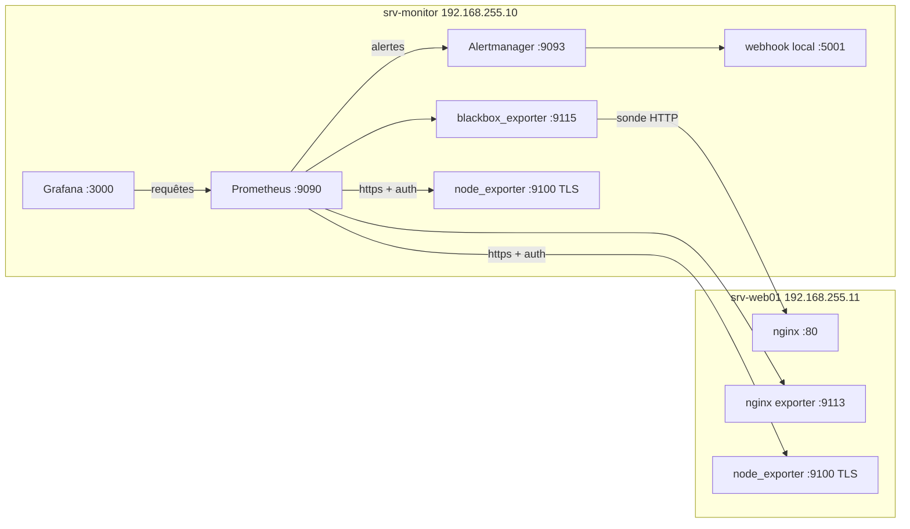

# Supervision d'un service web avec Prometheus, Alertmanager et Grafana

Projet réalisé pendant la formation Administrateur système DevOps (M2i), par Wahid E.

## Résumé

Deux serveurs AlmaLinux 10 : `srv-monitor` supervise `srv-web01`, qui héberge une application web simulée (nginx).
- Indicateurs choisis à partir d'un SLA simulé, en trois familles : ressources, sécurité, performance applicative.
- Collecte sécurisée : TLS et authentification basique sur node_exporter.
- 15 règles d'alerte testées avec `promtool`, routées par Alertmanager selon la sévérité.
- Quatre incidents provoqués, détectés, interprétés et corrigés.
- Tableau de bord Grafana provisionné par fichiers, et playbook Ansible qui vérifie et rétablit l'état attendu.


## Contexte et problème

Un client (simulé) exige pour son site : disponibilité de 99,5 % par mois, temps de réponse inférieur à 500 ms, détection d'un incident en moins de 2 minutes et correctifs de sécurité appliqués sous 30 jours. Il faut des indicateurs qui permettent de vérifier ces engagements, des alertes qui préviennent avant la violation du SLA, et un moyen d'en rendre compte aux développeurs.

Le détail des engagements et le catalogue d'indicateurs sont dans [docs/sla-indicateurs.md](docs/sla-indicateurs.md).

## Architecture



| Machine | Rôle | IP | Ressources |
|---|---|---|---|
| srv-monitor | Prometheus, Alertmanager, blackbox_exporter, Grafana, node_exporter, nœud de contrôle Ansible | 192.168.255.10 | 2 vCPU, 4 Go |
| srv-web01 | Application simulée : nginx, nginx exporter, node_exporter | 192.168.255.11 | 1 vCPU, 2 Go |

Les deux VM tournent sous VMware Workstation (réseau NAT), avec SELinux en mode Enforcing et firewalld actif. Les ports de supervision ne sont ouverts qu'à la source qui en a besoin.

## Technologies

| Outil | Version | Rôle |
|---|---|---|
| AlmaLinux | 10.2 Minimal | Système des deux serveurs |
| Prometheus + promtool | 3.15.1 | Collecte, stockage, évaluation des règles |
| node_exporter | 1.12.1 | Métriques système (collecteurs systemd et textfile) |
| nginx-prometheus-exporter | 1.5.3 | Métriques nginx (via `stub_status`) |
| blackbox_exporter | 0.29.1 | Sonde HTTP : disponibilité et temps de réponse |
| Alertmanager + amtool | 0.34.2 | Routage, regroupement et inhibition des alertes |
| Grafana | 13.3.0 | Tableaux de bord |
| ansible-core | 2.16.16 | Contrôle de conformité des deux serveurs |

## Déroulé

### 1. Installer les agents sur les deux serveurs

node_exporter est installé à la main sur chaque serveur, avec les bonnes pratiques habituelles. L'archive est vérifiée par SHA-256, le service tourne sous un utilisateur système sans shell, et le binaire reçoit le bon contexte SELinux. L'unité systemd est durcie (`NoNewPrivileges`, `ProtectSystem`, `ProtectHome`).

```bash
sha256sum -c sha256sums.txt --ignore-missing
sudo useradd --system --no-create-home --shell /usr/sbin/nologin node_exporter
sudo install -o root -g root -m 0755 node_exporter /usr/local/bin/node_exporter
sudo restorecon -v /usr/local/bin/node_exporter
```

Sur srv-web01, le port 9100 n'est ouvert qu'à srv-monitor :

```bash
sudo firewall-cmd --permanent --add-rich-rule='rule family="ipv4" source address="192.168.255.10" port port="9100" protocol="tcp" accept'
sudo firewall-cmd --reload
```

### 2. Sécuriser la collecte (TLS + authentification)

Sans protection, quiconque joint le port 9100 lit les métriques. Le script [scripts/enable_tls_node_exporter.sh](scripts/enable_tls_node_exporter.sh) fait le travail en une fois :
- il crée un certificat auto-signé qui contient les IP des deux serveurs ;
- il génère un mot de passe aléatoire, jamais affiché, et en stocke le hash bcrypt (`htpasswd`) dans le `web.yml` de node_exporter ;
- côté Prometheus, il range le mot de passe dans un fichier en droits 640.

Prometheus scrute ensuite en `https` avec `basic_auth` et le certificat comme autorité.

Vérification : sans identifiants, la réponse est 401 ; les deux cibles sont UP en https.


### 3. Couvrir les trois familles d'indicateurs

- **Ressources** : node_exporter (CPU, mémoire, disque, réseau).
- **Performance applicative** : `stub_status` de nginx publié en local seulement ([configs/nginx_status.conf](configs/nginx_status.conf)) et lu par nginx exporter. blackbox_exporter fait de vraies requêtes HTTP pour mesurer la disponibilité et le temps de réponse vus par l'utilisateur.
- **Sécurité** : aucun exporter n'existe pour ces mesures. Le script [scripts/security_metrics.sh](scripts/security_metrics.sh) compte les échecs SSH des 5 dernières minutes, les mises à jour de sécurité en attente et l'état de SELinux. Il est lancé toutes les 5 minutes par un timer systemd et lu par le textfile collector.


### 4. Écrire et tester les règles d'alerte

[configs/alertes.yml](configs/alertes.yml) contient 15 règles en trois groupes (ressources, disponibilité, sécurité). Les seuils sont placés avant les limites du SLA, avec une durée `for` qui évite les alertes sur un simple pic. Les règles sont validées puis testées sur des séries simulées ([configs/alertes_test.yml](configs/alertes_test.yml)) avant d'être chargées :

```bash
promtool check rules alertes.yml
promtool test rules alertes_test.yml
```


### 5. Router les alertes

[configs/alertmanager.yml](configs/alertmanager.yml) envoie les alertes `critical` vers l'astreinte (répétition toutes les heures) et le reste vers l'équipe système. Une règle d'inhibition masque l'alerte `warning` d'une instance quand une `critical` existe déjà pour elle. En laboratoire, le récepteur est un petit webhook local ([scripts/webhook_logger.py](scripts/webhook_logger.py)) qui écrit les alertes dans le journal : il n'y a ainsi aucun identifiant de messagerie à stocker. Le routage se vérifie avec `amtool config routes test`.

### 6. Provoquer et interpréter quatre incidents

Chaque incident est provoqué sur srv-web01, puis traité dans le même ordre : alerte reçue, diagnostic, correction, vérification du retour à la normale. Le détail est dans [docs/incidents.md](docs/incidents.md).

| Incident | Alerte | Équipe | Correction |
|---|---|---|---|
| nginx arrêté | `NginxArrete`, `SiteInaccessible` (critical) | astreinte | `systemctl start nginx` |
| CPU saturé (`dd` sur 1 vCPU) | `CPUCritique` (la warning est inhibée) | astreinte | `top`, puis `pkill -x dd` |
| 13 échecs SSH sur un compte inexistant | `EchecsConnexionSSH` (warning) | équipe système | Recommandations : clés uniquement, Fail2Ban |
| Disque rempli à 85 % (`fallocate`) | `DisqueRempli80` (warning) | équipe système | Fichier trouvé avec `du`, puis supprimé |


L'incident disque a aussi révélé un faux positif. `DisquePleinDans4h` (`predict_linear` sur 1 h) s'est déclenchée alors que le disque était déjà revenu à 9 % : la fenêtre d'une heure contenait la chute brutale de l'espace libre.


### 7. Afficher les indicateurs dans Grafana

Grafana est installé depuis le dépôt officiel ([scripts/install_grafana.sh](scripts/install_grafana.sh)) et durci par variables d'environnement : pas d'inscription, pas d'accès anonyme, pas de télémétrie, cookie `SameSite` strict. La source de données et le tableau de bord sont décrits dans des fichiers ([configs/grafana](configs/grafana)) et déployés par [scripts/deploy_grafana.sh](scripts/deploy_grafana.sh). Le tableau de bord compte 10 panneaux : hôtes UP, sonde du site, temps de réponse, alertes actives, CPU, mémoire, disque, réseau, connexions nginx et échecs SSH. Une variable permet de filtrer par instance, et les alertes apparaissent en annotations.

Ci-dessous, 12 h de fonctionnement : les lignes rouges sont les incidents, avec le pic CPU, le pic disque et les échecs SSH.


### 8. Rendre compte aux développeurs

Deux rapports ont été rédigés à deux moments. Le premier suit les incidents : disponibilité de 97,9 %, sous l'objectif de 99,5 %, CPU à 100 %, disque à 84 %, 13 échecs SSH. Le second est fait après le retour à la normale : aucune alerte, CPU à 1,4 %, disque à 8,7 %. Chacun donne la fenêtre de mesure, les pics, les constats et les actions demandées.

### 9. Contrôler la conformité avec Ansible

Depuis srv-monitor, l'[inventaire](ansible/inventory.ini) et le [playbook](ansible/site.yml) décrivent l'état attendu :
- SELinux en mode Enforcing et firewalld actif ;
- node_exporter et le timer des indicateurs de sécurité actifs ;
- nginx avec son `stub_status` et son exporter ;
- les services de supervision démarrés.

```bash
ansible all -i inventory.ini -m ping
ansible-playbook -i inventory.ini site.yml -K
```

Sur un état conforme, le résultat est `changed=0`.


Démonstration de dérive : nginx est arrêté volontairement (`ansible web -b -K -m service -a 'name=nginx state=stopped'`) et le site ne répond plus. À la relance, le playbook redémarre nginx (`changed=1`) et le site répond de nouveau en HTTP 200.


## Problèmes rencontrés

| Symptôme | Cause | Correction |
|---|---|---|
| `sudo: promtool: command not found` | Le `secure_path` de sudo ne contient pas `/usr/local/bin` | Chemin complet `/usr/local/bin/promtool` |
| `tar: command not found` | Image AlmaLinux Minimal | `dnf install -y tar` |
| Prometheus ne scrute plus `localhost:9100` après le passage en TLS | Le certificat ne couvre que les IP des serveurs | Scruter par l'IP |
| Fichier copié sur la VM différent de l'original | Erreur de transfert | Contrôle systématique par `sha256sum` |
| `amtool config routes test` : permission denied | Configuration en droits 640 | Test sur une copie |
| `dnf install grafana` bloqué | Lancé sans sudo, l'invite d'import de la clé GPG n'apparaissait pas | `sudo dnf install -y grafana` |
| `DisquePleinDans4h` déclenchée avec un disque à 9 % | `predict_linear` sur 1 h inclut une chute brutale | Limite notée : fenêtre plus longue ou condition de seuil |

## Pistes pour la production

- Une autorité de certification interne, un certificat par hôte avec rotation, et des secrets dans un coffre, au lieu d'un certificat auto-signé et d'un mot de passe partagés.
- Un vrai canal de notification (messagerie, outil d'astreinte) et une authentification devant Alertmanager et Prometheus.
- Les échecs SSH sont détectés avec 0 à 5 min de retard, à cause du timer : passer à 1 min ou utiliser un exporter de logs.
- Plusieurs sondes de disponibilité, depuis plusieurs points du réseau.
- Des seuils ajustés après plusieurs semaines de mesures réelles.
- Un playbook organisé en rôles qui installe tous les composants, avec `ansible-vault`, et rejoué sur des serveurs vierges.
- Une sauvegarde des données de Prometheus et de Grafana.

## Comment reproduire

1. Créer deux VM AlmaLinux 10 Minimal sur le même réseau. Si les IP sont différentes, les adapter dans les fichiers.
2. Installer node_exporter sur les deux serveurs, puis Prometheus, Alertmanager, blackbox_exporter et nginx exporter à partir des archives officielles. Utiliser les unités de [configs](configs).
3. Activer TLS et l'authentification avec `scripts/enable_tls_node_exporter.sh`.
4. Copier `configs/alertes.yml` dans `/etc/prometheus/rules/`, le valider avec `promtool`, puis recharger Prometheus.
5. Installer Grafana avec `scripts/install_grafana.sh`, puis déployer le provisioning avec `scripts/deploy_grafana.sh`.
6. Lancer `ansible-playbook -i ansible/inventory.ini ansible/site.yml -K` pour vérifier l'état attendu.

## Structure du dépôt

```
ansible/   inventaire et playbook de conformité
configs/   règles d'alerte et tests, Alertmanager, blackbox, unités systemd, provisioning Grafana
docs/      SLA et catalogue d'indicateurs, interprétation des incidents
scripts/   TLS de node_exporter, indicateurs de sécurité, installation et déploiement de Grafana, webhook
img/       captures
```
