# Supervision d'un service web avec Prometheus, Alertmanager et Grafana

Projet réalisé par Wahid E. pendant la formation Administrateur système DevOps (M2i).

## Résumé

J'ai monté la supervision de deux serveurs AlmaLinux 10 : `srv-monitor` surveille `srv-web01`, qui héberge une application web simulée (nginx). Les indicateurs viennent d'un SLA simulé et couvrent les ressources, la sécurité et la performance applicative. La collecte passe en TLS avec authentification. Quinze règles d'alerte, testées avec `promtool`, partent vers Alertmanager, qui les route selon leur sévérité. J'ai provoqué quatre incidents pour vérifier que chaque alerte arrive à la bonne équipe, puis je les ai corrigés. Grafana est configuré par fichiers, et un playbook Ansible remet les serveurs dans l'état attendu.

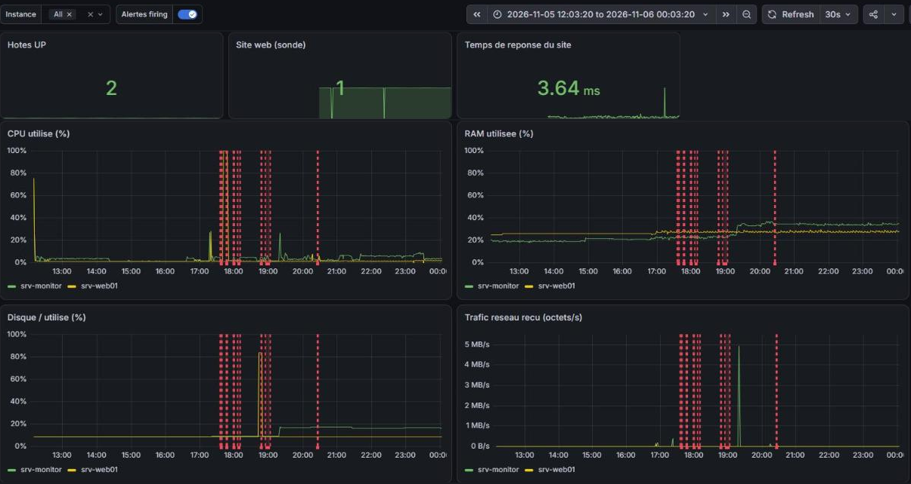

## Contexte

Le client (simulé) demande pour son site une disponibilité de 99,5 % par mois et un temps de réponse sous 500 ms. Un incident doit être détecté en moins de 2 minutes, et les correctifs de sécurité appliqués sous 30 jours. Il me fallait donc des mesures pour vérifier ces engagements, des alertes déclenchées avant que le SLA soit violé, et un moyen d'en rendre compte aux développeurs.

Les engagements et le catalogue d'indicateurs sont dans [docs/sla-indicateurs.md](docs/sla-indicateurs.md).

## Architecture

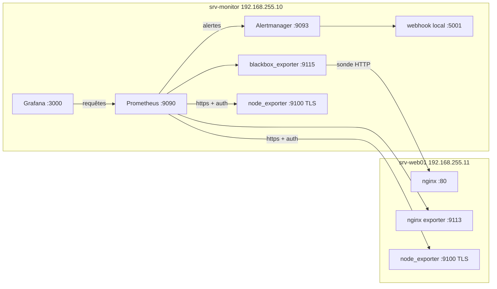

| Machine | Rôle | IP | Ressources |
|---|---|---|---|
| srv-monitor | Prometheus, Alertmanager, blackbox_exporter, Grafana, node_exporter, nœud de contrôle Ansible | 192.168.255.10 | 2 vCPU, 4 Go |
| srv-web01 | Application simulée : nginx, nginx exporter, node_exporter | 192.168.255.11 | 1 vCPU, 2 Go |

Les deux VM tournent sous VMware Workstation en réseau NAT, avec SELinux en mode Enforcing et firewalld. Chaque port de supervision n'est ouvert qu'à la machine qui l'interroge.

## Technologies

| Outil | Version | Rôle |
|---|---|---|
| AlmaLinux | 10.2 Minimal | Système des deux serveurs |
| Prometheus + promtool | 3.15.1 | Collecte, stockage, évaluation des règles |
| node_exporter | 1.12.1 | Métriques système (collecteurs systemd et textfile) |
| nginx-prometheus-exporter | 1.5.3 | Métriques nginx (via `stub_status`) |
| blackbox_exporter | 0.29.1 | Sonde HTTP : disponibilité et temps de réponse |
| Alertmanager + amtool | 0.34.2 | Routage, regroupement et inhibition des alertes |
| Grafana | 13.3.0 | Tableaux de bord |
| ansible-core | 2.16.16 | Contrôle de conformité des deux serveurs |

## Déroulé

### 1. Installer les agents et Prometheus

J'ai installé node_exporter à la main sur les deux serveurs. Je vérifie l'archive par SHA-256, le service tourne sous un utilisateur système sans shell, et le binaire reçoit son contexte SELinux. L'unité systemd ([configs/node_exporter.service](configs/node_exporter.service)) limite ce que le service peut faire avec `NoNewPrivileges`, `ProtectSystem` et `ProtectHome`.

```bash
sha256sum -c sha256sums.txt --ignore-missing
sudo useradd --system --no-create-home --shell /usr/sbin/nologin node_exporter
sudo install -o root -g root -m 0755 node_exporter /usr/local/bin/node_exporter
sudo restorecon -v /usr/local/bin/node_exporter
```

Sur srv-web01, le port 9100 n'accepte que srv-monitor :

```bash
sudo firewall-cmd --permanent --add-rich-rule='rule family="ipv4" source address="192.168.255.10" port port="9100" protocol="tcp" accept'
sudo firewall-cmd --reload
```

Prometheus suit la même méthode. Son unité ([configs/prometheus.service](configs/prometheus.service)) garde 15 jours de données et se recharge par `SIGHUP`. [configs/prometheus.yml](configs/prometheus.yml) interroge quatre jobs toutes les 15 s : `prometheus`, `node` (en https avec authentification), `nginx` et `blackbox_http`, dont le `relabel_configs` transmet l'adresse du site à la sonde. Le fichier charge aussi les règles de `rules/` et déclare Alertmanager. Je le valide avant chaque rechargement :

```bash
promtool check config /etc/prometheus/prometheus.yml
sudo systemctl reload prometheus
```

### 2. Sécuriser la collecte (TLS + authentification)

Sans protection, n'importe quelle machine qui joint le port 9100 lit les métriques. Le script [scripts/enable_tls_node_exporter.sh](scripts/enable_tls_node_exporter.sh) crée un certificat auto-signé valable pour les IP des deux serveurs. Il génère aussi un mot de passe aléatoire, jamais affiché, et place son hash bcrypt (`htpasswd`) dans le `web.yml` de node_exporter. Côté Prometheus, le mot de passe va dans un fichier en droits 640, et le certificat sert d'autorité pour vérifier la connexion.

Sans identifiants, node_exporter répond 401, et les deux cibles restent UP en https.

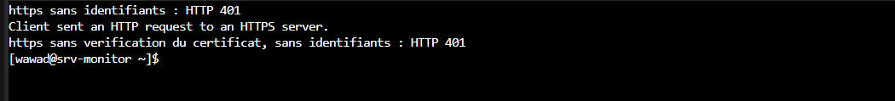
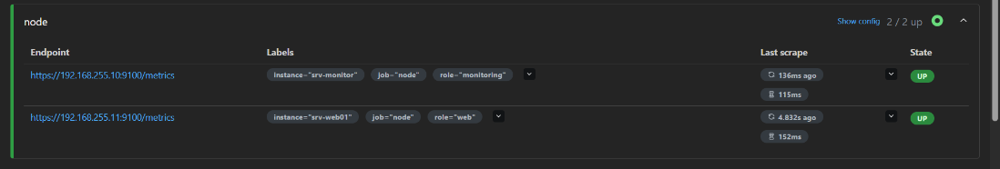

### 3. Couvrir ressources, performance et sécurité

node_exporter fournit le CPU, la mémoire, le disque et le réseau. Pour l'application, nginx publie son `stub_status` en local seulement ([configs/nginx_status.conf](configs/nginx_status.conf)), et nginx exporter le traduit en métriques. blackbox_exporter envoie de vraies requêtes HTTP au site : il mesure ainsi la disponibilité et le temps de réponse tels que l'utilisateur les voit.

Aucun exporter ne donnait les indicateurs de sécurité dont j'avais besoin. J'ai donc écrit [scripts/security_metrics.sh](scripts/security_metrics.sh), qui compte les échecs SSH des 5 dernières minutes et les mises à jour de sécurité en attente, et relève l'état de SELinux. Un timer systemd le lance toutes les 5 minutes, et le textfile collector de node_exporter publie le résultat.

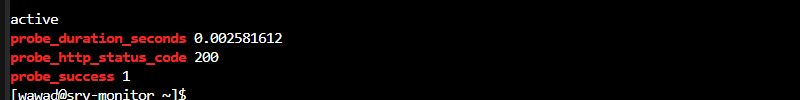
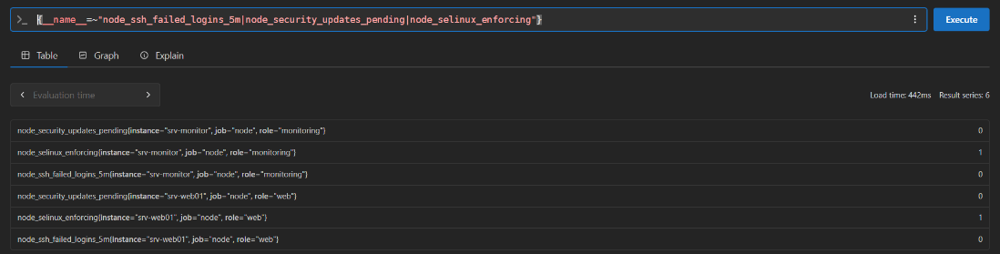

### 4. Écrire et tester les règles d'alerte

[configs/alertes.yml](configs/alertes.yml) regroupe 15 règles : ressources, disponibilité et sécurité. Chaque seuil est placé avant la limite du SLA, et la durée `for` évite de déclencher une alerte sur un simple pic. Avant de charger les règles, je les valide, puis je les rejoue sur des séries simulées ([configs/alertes_test.yml](configs/alertes_test.yml)) :

```bash
promtool check rules alertes.yml
promtool test rules alertes_test.yml
```

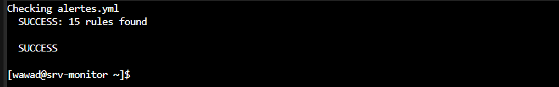

### 5. Router les alertes

Dans [configs/alertmanager.yml](configs/alertmanager.yml), les alertes `critical` partent vers l'astreinte et sont répétées toutes les heures, les autres vers l'équipe système. Quand une instance a déjà une alerte `critical`, une règle d'inhibition masque sa `warning`. En laboratoire, le récepteur est un petit webhook local ([scripts/webhook_logger.py](scripts/webhook_logger.py)) qui écrit les alertes dans le journal, ce qui m'évite de stocker un identifiant de messagerie. `amtool config routes test` montre vers quel récepteur part une alerte donnée.

### 6. Provoquer et interpréter quatre incidents

J'ai provoqué chaque incident sur srv-web01 et je l'ai traité dans le même ordre : lecture de l'alerte, diagnostic, correction, puis contrôle du retour à la normale. Le détail est dans [docs/incidents.md](docs/incidents.md).

| Incident | Alerte | Équipe | Correction |
|---|---|---|---|
| nginx arrêté | `NginxArrete`, `SiteInaccessible` (critical) | astreinte | `systemctl start nginx` |
| CPU saturé (`dd` sur 1 vCPU) | `CPUCritique` (la warning est inhibée) | astreinte | `top`, puis `pkill -x dd` |
| 13 échecs SSH sur un compte inexistant | `EchecsConnexionSSH` (warning) | équipe système | Recommandations : clés uniquement, Fail2Ban |
| Disque rempli à 85 % (`fallocate`) | `DisqueRempli80` (warning) | équipe système | Fichier trouvé avec `du`, puis supprimé |

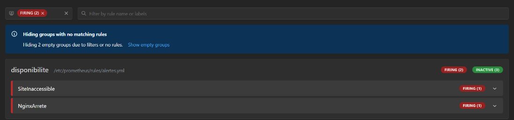
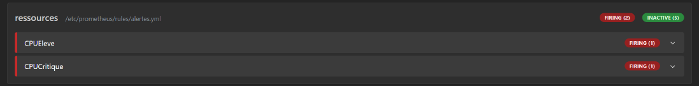
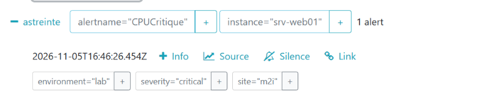
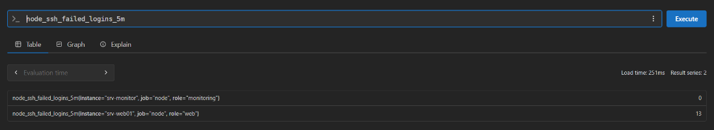
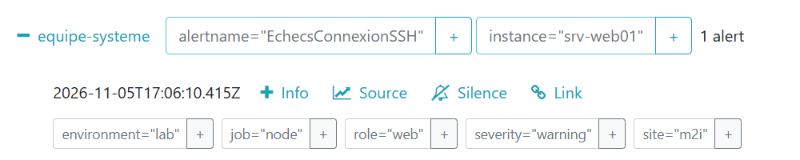
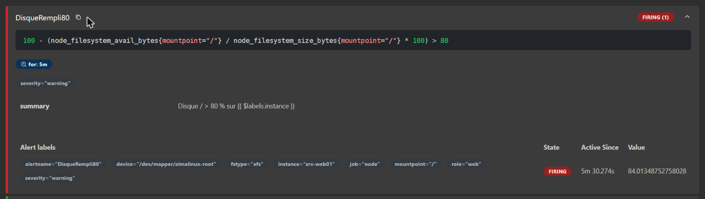

Pendant l'incident disque, `DisquePleinDans4h` (`predict_linear` sur 1 h) s'est déclenchée alors que le disque était déjà redescendu à 9 %. La fenêtre d'une heure contenait la chute brutale de l'espace libre, et la projection en a déduit un remplissage rapide.

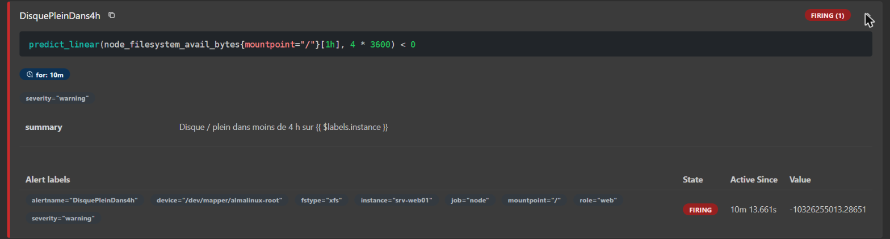

### 7. Afficher les indicateurs dans Grafana

J'ai installé Grafana depuis le dépôt officiel ([scripts/install_grafana.sh](scripts/install_grafana.sh)). Des variables d'environnement désactivent l'inscription, l'accès anonyme et la télémétrie, et passent le cookie en `SameSite` strict. La source de données et le tableau de bord sont décrits dans des fichiers ([configs/grafana](configs/grafana)), que [scripts/deploy_grafana.sh](scripts/deploy_grafana.sh) met en place. Le tableau de bord compte 10 panneaux : hôtes UP, sonde du site, temps de réponse, alertes actives, CPU, mémoire, disque, réseau, connexions nginx et échecs SSH. On peut le filtrer par instance, et les alertes y apparaissent en annotations.

Sur ces 12 h de fonctionnement, les lignes rouges marquent les incidents : on retrouve le pic CPU, le pic disque et la rafale d'échecs SSH.

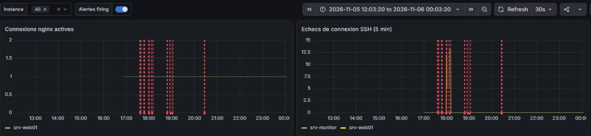
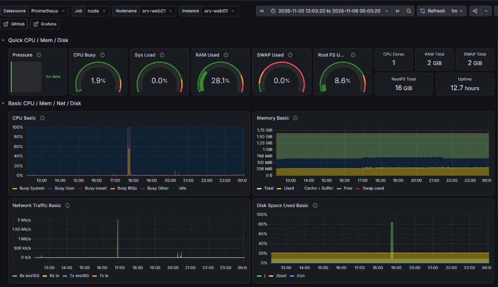

### 8. Rendre compte aux développeurs

J'ai écrit deux rapports. Le premier, juste après les incidents, relève une disponibilité de 97,9 % (sous l'objectif de 99,5 %), un CPU à 100 %, un disque à 84 % et 13 échecs SSH. Le second, après le retour à la normale, ne relève plus aucune alerte, avec un CPU à 1,4 % et un disque à 8,7 %. Chaque rapport précise la fenêtre de mesure, les pics, ce que j'en conclus et ce que je demande aux développeurs.

### 9. Contrôler la conformité avec Ansible

Depuis srv-monitor, l'[inventaire](ansible/inventory.ini) et le [playbook](ansible/site.yml) vérifient que SELinux est en mode Enforcing et que firewalld, node_exporter et le timer de sécurité tournent. Ils contrôlent aussi nginx avec son `stub_status` et son exporter, ainsi que les services de supervision.

```bash
ansible all -i inventory.ini -m ping
ansible-playbook -i inventory.ini site.yml -K
```

Sur des serveurs conformes, le playbook ne change rien (`changed=0`).

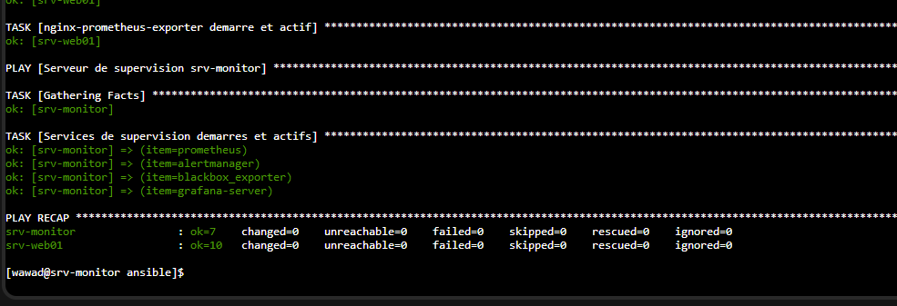

Pour vérifier qu'il corrige une dérive, j'ai arrêté nginx avec `ansible web -b -K -m service -a 'name=nginx state=stopped'`. Le site ne répondait plus. À la relance, le playbook a redémarré nginx (`changed=1`), et le site a de nouveau répondu en HTTP 200.

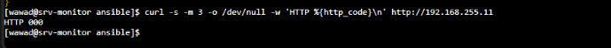
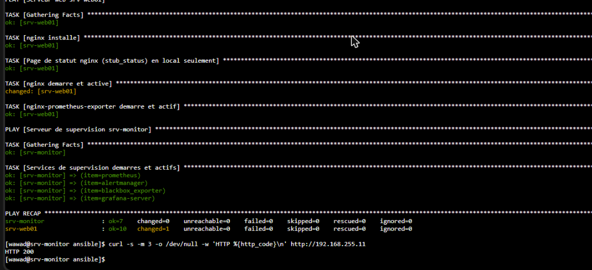

## Problèmes rencontrés

| Symptôme | Cause | Correction |
|---|---|---|
| `sudo: promtool: command not found` | Le `secure_path` de sudo ne contient pas `/usr/local/bin` | Chemin complet `/usr/local/bin/promtool` |
| `tar: command not found` | Image AlmaLinux Minimal | `dnf install -y tar` |
| Prometheus ne scrute plus `localhost:9100` après le passage en TLS | Le certificat ne couvre que les IP des serveurs | Scruter par l'IP |
| Fichier copié sur la VM différent de l'original | Erreur de transfert | Contrôle par `sha256sum` après chaque copie |
| `amtool config routes test` : permission denied | Configuration en droits 640 | Test sur une copie |
| `dnf install grafana` bloqué | Lancé sans sudo, l'invite d'import de la clé GPG n'apparaissait pas | `sudo dnf install -y grafana` |
| `DisquePleinDans4h` déclenchée avec un disque à 9 % | `predict_linear` sur 1 h inclut une chute brutale | Limite notée : fenêtre plus longue ou condition de seuil |

## Pistes pour la production

Le certificat auto-signé et le mot de passe partagés par les deux serveurs suffisent en laboratoire. En production, je passerais à une autorité de certification interne, avec un certificat par hôte, une rotation et des secrets rangés dans un coffre. Les alertes partiraient vers un vrai canal (messagerie ou outil d'astreinte), et Alertmanager comme Prometheus seraient derrière une authentification.

Le timer de 5 minutes retarde la détection des échecs SSH de 0 à 5 minutes. Un timer d'une minute ou un exporter de logs réglerait ce retard. La disponibilité gagnerait à être mesurée depuis plusieurs points du réseau. Quant aux seuils, ils restent à ajuster après quelques semaines de mesures réelles.

Côté automatisation, il manque un playbook découpé en rôles qui installe tous les composants, avec `ansible-vault`, et rejoué sur des serveurs vierges. Il manque aussi une sauvegarde des données de Prometheus et de Grafana.

## Comment reproduire

1. Créer deux VM AlmaLinux 10 Minimal sur le même réseau. Si les IP sont différentes, les adapter dans les fichiers.
2. Installer node_exporter sur les deux serveurs, puis Prometheus, Alertmanager, blackbox_exporter et nginx exporter à partir des archives officielles, avec les unités de [configs](configs).
3. Activer TLS et l'authentification avec `scripts/enable_tls_node_exporter.sh`.
4. Copier `configs/prometheus.yml` dans `/etc/prometheus/` et `configs/alertes.yml` dans `/etc/prometheus/rules/`, valider avec `promtool check config` et `promtool check rules`, puis recharger Prometheus.
5. Installer Grafana avec `scripts/install_grafana.sh`, puis déployer le provisioning avec `scripts/deploy_grafana.sh`.
6. Lancer `ansible-playbook -i ansible/inventory.ini ansible/site.yml -K` pour vérifier l'état attendu.

## Structure du dépôt

```
ansible/   inventaire et playbook de conformité
configs/   prometheus.yml, règles d'alerte et tests, Alertmanager, blackbox, unités systemd, provisioning Grafana
docs/      SLA et catalogue d'indicateurs, interprétation des incidents
scripts/   TLS de node_exporter, indicateurs de sécurité, installation et déploiement de Grafana, webhook
img/       captures
```
